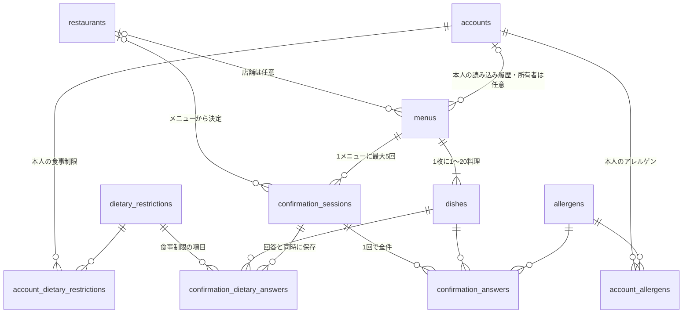

# DB仕様

本書はテーブル・マスタ・保存処理・権限の設計。SQLは `supabase/migrations/` の5ファイルで実装し、2026-10-17にSupabaseプロジェクト `Meelyze-plus`（本番兼用）へ適用・検証した。RPCの呼び出し例・取得SQL例・検証結果・適用手順は [Supabase README](../supabase/README.md)、APIと予測計算は [api.md](api.md) を参照する。本書とマイグレーションを一致させ、変更は新しいマイグレーションと本書の更新で行う。

## 全体像

確認用の8テーブルとアカウント用の3テーブル（P1）の計11テーブル、DB関数4つ（RPC）、検証用トリガー、公開ビュー3つ、非公開のStorageバケット1つで構成する。判定の結果を保存するテーブルや、ログイン用のセッションテーブルは作らない。SupabaseのAuth（`auth.users`）は使わない。

本人履歴は `menus.account_id` で識別する。選択したアレルゲン・食事制限はメニューへコピーせず、公開ビューにはアカウント情報を含めない。

| テーブル | 1行の単位 | 役割 |
|---|---|---|
| `restaurants` | 店舗1件 | Google MapsのPlace IDとMeelyze+内のIDの対応 |
| `menus` | 撮影画像1枚 | 非公開画像のパス、解析用トークンのハッシュと期限、所有者ID・登録時同意のスナップショット |
| `dishes` | メニュー内の料理1件 | 料理名・照合キー・価格・英訳と英語の説明・AIの候補（JSONB） |
| `allergens` | アレルゲン1種 | APIとVLMで共有する29品目のID・日英名・分類・表示順 |
| `confirmation_sessions` | 店員確認カード1回分 | 公開可否、再送判定用の `request_id`、確認日時 |
| `confirmation_answers` | 確認×料理×アレルゲン | 店員の回答 |
| `accounts`（P1） | 登録した利用者1人 | 固有ID、メールアドレス、ニックネーム、パスワードのハッシュ、登録時公開同意の記録 |
| `account_allergens`（P1） | アカウント×アレルゲン | 本人が登録したアレルゲン |
| `dietary_restrictions` | 食事制限1種 | 選択式4種類のID・code・日英名 |
| `confirmation_dietary_answers` | 確認×料理×食事制限 | 食事制限への店員回答 |
| `account_dietary_restrictions`（P1） | アカウント×食事制限 | 本人が登録した食事制限 |

## テーブル定義

### `restaurants`

| 列 | 型 | 制約・説明 |
|---|---|---|
| `id` | uuid | PK。`gen_random_uuid()` |
| `google_place_id` | text | 必須・一意。1〜255文字 |
| `created_at` | timestamptz | `now()` |

- 店名・座標・住所はGoogle Mapsの利用規約に合わせて保存しない。表示時にGoogleから取得する。
- APIが解析時に、Place Details で存在を確認してから登録する（既にあれば再利用）。

### `menus`

| 列 | 型 | 制約・説明 |
|---|---|---|
| `id` | uuid | PK |
| `restaurant_id` | uuid | 任意。`restaurants` への外部キー（削除制限）。NULLは店舗未選択 |
| `account_id` | uuid | 任意。`accounts` への外部キー（削除制限）。P1の追加マイグレーションで追加。解析時のJWTから決定し、ゲストはNULL |
| `user_publish_consent` | boolean | 必須、既定false。解析保存RPCが登録時の利用者同意をコピー。ゲストはfalse。初期スキーマから定義する |
| `image_path` | text | 必須・一意。非公開バケット内のランダムなパス |
| `analysis_token_hash` | text | 必須・一意。解析用トークンのSHA-256（小文字16進64文字） |
| `analysis_expires_at` | timestamptz | 既定は作成から24時間後。`created_at` より後 |
| `created_at` | timestamptz | `now()` |

作成後は所有者・同意も含めて更新できない（`trg_menu_immutable`）。P1では `account_id IS NOT NULL OR user_publish_consent = false` をチェックする。所有者IDはクライアント入力を使わず、APIが検証したJWTから渡す。

### `dishes`

| 列 | 型 | 制約・説明 |
|---|---|---|
| `id` | uuid | PK |
| `menu_id` | uuid | 必須。`menus` への外部キー |
| `name` | text | 必須。メニュー上の原文、1〜200文字 |
| `position` | smallint | 必須、1〜20。解析結果の配列順を保存。`(menu_id, position)` で一意 |
| `name_key` | text | 必須。照合用キー。APIが `name` をNFKC正規化し、空白を除いて小文字にした値 |
| `translations` | jsonb | 必須のオブジェクト。`{"en":{"name":"...","description":"..."}}`。MVPは `en` のみ |
| `price` | numeric(10,2) | 任意。0以上。読めない場合はNULL |
| `currency` | char(3) | 既定 `JPY` |
| `version` | integer | 既定1。MVPでは編集しないため常に1 |
| `ai_result` | jsonb | 必須のオブジェクト。`{"ingredients":[],"allergens":[],"dietary_restrictions":[]}` 形式 |
| `ai_model` | text | 必須。APIが付与 |
| `prompt_version` | text | 必須。新規解析はAPIが `v5` を付与。保存済みの `v4` も読取可能 |
| `analyzed_at` / `created_at` | timestamptz | `now()` |

作成後は更新できない（`trg_dish_immutable`）。

`ai_result` の候補は項目ID・`status`・`source`・`evidence` を持つ。値の組・重複・英訳の形式は [APIの判定アルゴリズム](api.md#判定アルゴリズム) とJSON Schemaで検証し、DBではJSONオブジェクトであることを保証する。料理の取得は `position` 順とし、新しい撮影では新しいIDを発行する。

### `allergens`

| 列 | 型 | 制約・説明 |
|---|---|---|
| `id` | smallint | PK。identity。seedの値をAPI・VLMで共有 |
| `code` | text | 一意。`^[a-z][a-z_]*$` |
| `name` / `name_en` | text | 日本語名（一意）／英語名 |
| `category` | text | 必須。`required`（9品目）／`recommended`（20品目） |
| `display_order` | smallint | 必須・一意、1〜29。ユーザー指定の分類内の順番 |

初期データは本書の [アレルゲンマスタ](#allergen-master) に従う。IDと表示順は別に管理する。

### `confirmation_sessions`

| 列 | 型 | 制約・説明 |
|---|---|---|
| `id` | uuid | PK |
| `menu_id` | uuid | 必須。`menus` への外部キー |
| `restaurant_id` | uuid | 任意。メニューの店舗と一致すること（トリガーで検証）。APIからは指定させない |
| `request_id` | uuid | 必須。画面がカードごとに作る値。`(menu_id, request_id)` で一意 |
| `publish_consent` | boolean | 必須。店員が選んだ公開可否 |
| `created_at` | timestamptz | `now()`。確認日時（`confirmed_at`）として扱う |

- 回答と同時に作成し、作成後は更新できない（`trg_session_immutable`）。状態の列は持たない。
- 1つのメニューにつき最大5件（トリガーで検証）。

### `confirmation_answers`

| 列 | 型 | 制約・説明 |
|---|---|---|
| `id` | uuid | PK |
| `session_id` | uuid | 必須。`confirmation_sessions` への外部キー |
| `dish_id` / `allergen_id` | uuid / smallint | 必須。料理は確認と同じメニューのものに限る |
| `dish_version` | integer | 必須。回答時点の料理の版。RPCが料理の現在の版を保存し、APIからは送らない |
| `answer` | text | 必須。`contains`（含まれる）／`cross_contact`（同じ料理器具を使っている）／`not_contains`（含まれない）／`unknown`（わからない）。APIでは `cross_contact` を `shared_utensils`、`not_contains` を `does_not_contain` と呼び、APIが変換する（下記） |
| `created_at` | timestamptz | `now()` |

- 一意制約は `(session_id, dish_id, allergen_id)`。作成後は更新できない（`trg_answer_immutable`）。
- 未回答（欠落・null）は保存しない。明示的な `unknown` は有効な回答として保存する。食事制限のみを確認した場合は、このテーブルに行を作らない。
- 回答は確認をまたいで上書きせず、蓄積する。
- DBの値とAPIの値の対応（08の決定。DB・マイグレーションは変更しない）：`contains`↔`contains`、`cross_contact`↔`shared_utensils`、`not_contains`↔`does_not_contain`、`unknown`↔`unknown`。変換はAPIの `app/services/answers.py` の1か所で行い、RPCにはDBの値を渡す。
- `cross_contact` の意味は、旧ラベル「原材料ではないが器具を共有（交差接触）」から「対象を使う別の料理と器具を共有している。原材料への含有は未確認」に変わった。`not_contains` は原材料についての回答で、交差接触がないことは意味しない。2026-10-17時点で `Meelyze-plus` に回答はなく、旧ラベルで入力された回答の扱いは不要。
- 履歴の集計では `contains` をα、`not_contains` をβに加え、`cross_contact`・`unknown` は件数・日時だけに使う（[API仕様の判定アルゴリズム](api.md#判定アルゴリズム)）。

### `accounts`（P1）

| 列 | 型 | 制約・説明 |
|---|---|---|
| `id` | uuid | PK。`gen_random_uuid()`。アカウントの固有ID |
| `email` | text | 必須・一意。`email = lower(email)`・前後空白なし・3〜254文字のチェック制約。DBは検査だけを行い、正規化（前後空白の除去・小文字化）はAPIが保存前に行う |
| `nickname` | text | 必須。前後空白なし（APIが除去）・1〜30文字のチェック制約。一意ではない |
| `password_hash` | text | 必須。Argon2idのPHC形式で、`$argon2id$` で始まること |
| `publish_consent` | boolean | 必須。③の登録時の利用者の明示選択。falseでも登録可能 |
| `publish_consent_recorded_at` | timestamptz | 必須、DBの `now()`。同意・不同意の選択を記録した時刻。列権限によりAPIから値を指定できない |
| `publish_consent_version` | text | 必須。APIが管理する公開同意文言のバージョン。クライアントに指定させない |
| `created_at` / `updated_at` | timestamptz | `now()`。`updated_at` はパスワードの再ハッシュ時に更新する |

- パスワードの平文、ログイン用トークン、トークンのハッシュは保存しない。
- `id`・`publish_consent_recorded_at`・`created_at`・`updated_at` の初期値はDBが決める。登録時にAPIが指定できるのは `email`・`nickname`・`password_hash`・`publish_consent`・`publish_consent_version` だけ（[権限](#権限)）。
- メールアドレスの確認状態の列は持たない（メール確認はP2）。

### `account_allergens`（P1）

| 列 | 型 | 制約・説明 |
|---|---|---|
| `account_id` | uuid | 必須。`accounts` への外部キー（削除時カスケード） |
| `allergen_id` | smallint | 必須。`allergens` への外部キー（削除制限） |
| `created_at` | timestamptz | `now()` |

- 主キーは `(account_id, allergen_id)`。
- 行がないことは「登録したアレルゲンなし」を表す。「アレルギーがない」という確認ではない。
- 変更は `replace_account_allergens` による全件置換だけで行う。

### `dietary_restrictions`

| 列 | 型 | 制約・説明 |
|---|---|---|
| `id` | smallint | PK。seedの固定IDをAPI・VLMで共有 |
| `code` | text | 必須・一意。`^[a-z][a-z_]*$` |
| `name` / `name_en` | text | 必須。日本語名／英語名 |

初期データと確認条件は本書の [食事制限マスタ](#dietary-master) に従う。`dishes.ai_result.dietary_restrictions[]` の値はAPI・JSON Schemaで検証する。

### `confirmation_dietary_answers`

| 列 | 型 | 制約・説明 |
|---|---|---|
| `id` | uuid | PK |
| `session_id` | uuid | 必須。`confirmation_sessions` への外部キー |
| `dish_id` | uuid | 必須。`dishes` への外部キー。確認と同じメニュー |
| `dietary_restriction_id` | smallint | 必須。`dietary_restrictions` への外部キー |
| `dish_version` | integer | 必須。回答時点の料理の版。RPCが料理の現在の版を保存し、APIからは送らない |
| `answer` | text | 必須。`not_supported`／`supported`／`cross_contact`／`unknown`。APIでも同じ値。履歴の集計では `not_supported` をα、`supported` をβに加え、`cross_contact`・`unknown` は件数・日時だけ |
| `created_at` | timestamptz | `now()` |

一意制約は `(session_id, dish_id, dietary_restriction_id)`。アレルゲン回答と同じ確認に紐づけ、同じRPCで保存する。`unknown` は明示回答として許可し、未回答は拒否する。作成後は更新しない。

### `account_dietary_restrictions`（P1）

| 列 | 型 | 制約・説明 |
|---|---|---|
| `account_id` | uuid | 必須。`accounts` への外部キー（削除時カスケード） |
| `dietary_restriction_id` | smallint | 必須。`dietary_restrictions` への外部キー（削除制限） |
| `created_at` | timestamptz | `now()` |

主キーは `(account_id, dietary_restriction_id)`。変更は `replace_account_dietary_restrictions` の全件置換だけで行う。行がないことは未登録を表し、制限がないという確認ではない。

### インデックス

| 名前 | 対象 | 用途 |
|---|---|---|
| `idx_menus_restaurant` | `menus(restaurant_id)` | 店舗のメニュー取得 |
| `idx_menus_account_created` | `menus(account_id, created_at desc, id desc)` | 本人履歴を新しい順でページング（P1） |
| `idx_dishes_menu` | `dishes(menu_id)` | メニュー内の料理取得 |
| `idx_dishes_name_key` | `dishes(name_key)` | 同じ料理名の過去の確認の検索 |
| `idx_sessions_menu` / `idx_sessions_restaurant` | `confirmation_sessions` | 確認の検索、公開判定 |
| `idx_answers_dish_allergen_date` | `confirmation_answers(dish_id, allergen_id, created_at desc)` | 判定（履歴の集計）に使う回答の取得 |
| `accounts_email_key`（一意制約） | `accounts(email)` | ログイン時の検索、重複登録の拒否 |
| `account_allergens_pkey`（主キー） | `account_allergens(account_id, allergen_id)` | 本人のアレルゲン取得 |
| `idx_dietary_answers_dish_item_date` | `confirmation_dietary_answers(dish_id, dietary_restriction_id, created_at desc)` | 食事制限の過去回答検索 |
| `account_dietary_restrictions_pkey` | `account_dietary_restrictions(account_id, dietary_restriction_id)` | 本人の食事制限取得 |

## トリガー

| トリガー | 関数 | 内容 | エラー（SQLSTATE・メッセージ） |
|---|---|---|---|
| `trg_validate_session` | `validate_confirmation_session()` | メニュー行をロックし、店舗がメニューの店舗と一致すること、1メニューあたり5件以内であることを確認する。RPCを経由しない挿入にも適用 | `22023` `restaurant_mismatch`／`confirmation_limit_reached` |
| `trg_validate_answer`・`trg_validate_dietary_answer` | `validate_confirmation_answer()` | 料理が確認と同じメニューに属すること、料理の版が一致することを確認する | `22023` `dish_not_in_menu`／`dish_version_mismatch` |
| `trg_menu_immutable` / `trg_dish_immutable` / `trg_session_immutable` / `trg_answer_immutable`・`trg_dietary_answer_immutable` | `reject_snapshot_update()` | 更新を拒否する。所有者（`postgres`）の接続でも拒否される | `55000` `snapshot_is_immutable` |

## DB関数（RPC）

いずれも `security invoker`・`search_path` 空で定義し、`service_role` だけが実行できる。置換RPCは呼び出し元の権限で動くため、本人設定の2テーブルには `service_role` の `insert`・`delete` も付与する。APIは削除・追加を別々に呼ばず、RPCを通す。引数はPostgREST（Supabase SDKの `rpc`）からJSONで渡す。呼び出し例は [API README](../apps/api/README.md#supabaseの利用) を参照する。

### `save_menu_analysis(p_restaurant_id, p_image_path, p_analysis_token_hash, p_dishes, p_ai_model, p_prompt_version, p_analysis_expires_at, p_account_id)` → `uuid`

APIは構造・マスタIDを検証し、許可値内のstatus/source矛盾や空の根拠だけを `unknown`／`unavailable`／空の `evidence` にしてから `dishes.ai_result` に保存する。既存RPC・JSON形状を維持し、マイグレーションと旧データの書換えは不要。AIの不明によって確認セッション・店員回答を作成せず、利用者の選択設定も保存しない。

メニュー1件と料理1〜20件を、1つのトランザクションで登録し、`menu_id` を返す。途中で失敗すると、メニューも含めてロールバックする。`p_dishes`（JSON配列）の各要素は `name`・`name_key`（文字列）、`translations`・`ai_result`（オブジェクト）、`price`（数値かnull、省略可）、`currency`（文字列かnull、省略時 `JPY`）だけを持ち、それ以外のキーは拒否する。RPCが配列の順序を1始まりの `position` として保存する。`p_analysis_token_hash` は小文字16進64文字、`p_analysis_expires_at` 省略時は `now() + 24時間`。

P1の `p_account_id` はAPIが検証済みアカウントJWTの `sub` から渡す任意引数（既定NULL）。RPCがアカウントの存在を検証し `accounts.publish_consent` を読んで、所有者と利用者同意をメニューに保存する。利用者同意のbooleanはRPC引数にしない。NULLなら所有者なし・同意false。初期のP0用RPCは所有者引数なし・同意falseで作成し、アカウント作成後の追加マイグレーションで旧シグネチャを削除してこの定義へ置き換える。引数違いの旧関数を残さない。

Storageへの画像保存は別の処理になる。DB登録が失敗した場合は、FastAPIがStorage APIで画像を削除する。

| SQLSTATE | 例外メッセージ・内容 |
|---|---|
| `P0002` | `account_not_found`（`p_account_id` のアカウントがない） |
| `22023` | `dishes_invalid`（配列以外・0件／21件以上・要素の形式）、`invalid_analysis_token_hash` |
| `23514`・`23503`・`23505` | 料理名の長さ・負の価格・過去の期限などのチェック制約違反、存在しない店舗、画像パス・ハッシュの重複（制約のエラーをそのまま返す） |

### `complete_confirmation_session(p_menu_id, p_analysis_token_hash, p_request_id, p_answers, p_dietary_answers, p_publish_consent)`

⑭で選んだ公開可否と、⑬で入力したアレルゲン・食事制限の全回答を1回の呼び出しで保存する。⑬で別の確認行を先に作らない。

1. メニューの行を `FOR UPDATE` でロックし、トークンのハッシュと期限を検証する。
2. 両配列の合計回答数（1〜50）、料理の和集合（1〜10）、重複、値、料理とメニューの一致、未知の項目IDを検証する。各配列は料理集合×項目集合の全組を必要とし、両配列に回答がある場合は料理集合を一致させる。
3. 同じ `request_id` があれば、両配列を並べ替えて店員の公開可否と比較し、下表の再送処理を行う。
4. 新規の確認にだけ1メニュー5回の上限を適用する。確認行と両回答配列を一括保存し、いずれかが失敗すれば全体をロールバックする。
5. `session_id`、`confirmed_at`、`replayed` を1行で返す（OUT引数。PostgRESTでは単一のJSONオブジェクト）。

各要素は `{dish_id, allergen_id, answer}`／`{dish_id, dietary_restriction_id, answer}` のちょうど3キーとし、`dish_version` は受け取らない。

5回目の確認の再送も成功させるため、上限判定は再送判定の後に行う。期限切れは再送でも拒否する。

再送への対応：

| 状況 | 結果 |
|---|---|
| 同じ `request_id` で同じ内容を再送 | 両配列を項目順に正規化して公開可否も比較し、既存の確認を返し、`replayed=true`。行は増えない |
| 同じ `request_id` で違う内容を送信 | `40001`（409） |

| SQLSTATE | 例外メッセージ | API |
|---|---|---|
| `28000` | `invalid_analysis_token` | 401 |
| `P0002` | `menu_not_found` | 404 |
| `P0003` | `analysis_expired` | 410 |
| `40001` | `request_id_conflict` | 409 |
| `22023` | `answers_invalid`、`dish_not_in_menu`、`confirmation_limit_reached`、`validation_error`（`p_request_id`・`p_publish_consent` がnull） | 422 |

### `replace_account_allergens(p_account_id, p_allergen_ids)` → `smallint[]`（P1）

本人のアレルゲンを、1つのトランザクションで全件置き換える。`p_account_id` はFastAPIがアカウント用トークンの `sub` から渡し、クライアントの入力を使わない。

1. アカウント行を `FOR UPDATE` でロックする。ない場合は `P0002`（`account_not_found`）。同じ本人の同時保存を直列化する。
2. `p_allergen_ids`（整数のJSON配列）の形式・重複・未知のIDを検証する。配列以外・null・整数以外の要素も含め、不正なら `22023`（`invalid_allergen_ids`）。空配列は許可する。
3. 既存の行を削除し、指定のIDを追加する。途中で失敗した場合は元の行が残る。
4. 置き換え後の `allergen_ids` を昇順の配列で返す。

### `replace_account_dietary_restrictions(p_account_id, p_dietary_restriction_ids)` → `smallint[]`（P1）

本人の食事制限を1トランザクションで全件置換し、置き換え後のIDを昇順の配列で返す。引数は整数のJSON配列。アカウント行を `FOR UPDATE` でロックし、形式・重複・未知のIDを検証する。失敗時は元の設定を保つ。空配列は許可する。不正IDは `22023`（`invalid_dietary_restriction_ids`）、アカウントなしは `P0002`。本人のIDはAPIがトークンの `sub` から設定する。アレルゲンの置換とは別RPCであり、画面は両方の成功を確認して進む。

## 公開ビュー

3つとも `security_invoker=true` で定義する。

### `published_menus`

1行は、公開されたメニューの料理1件に対応する。

- 返す列：`menu_id`、`restaurant_id`、`google_place_id`、`scanned_at`（メニューの作成日時。代表料理の選択に使用）、`published_at`（そのメニューで最も新しい公開「はい」の確認日時）、`dish_id`、`dish_name`、`name_key`、`translations`、`price`、`currency`、`dish_version`、`ai_result`
- 公開条件：店舗あり、`menus.user_publish_consent=true`、そのメニューに店員の `publish_consent=true` の確認が1件以上あること。

### `published_confirmation_answers`

1行は、公開「はい」の確認の回答1件に対応する。

- 返す列：`session_id`、`restaurant_id`、`google_place_id`、`menu_id`、`dish_id`、`name_key`、`dish_version`、`allergen_id`、`answer`、`confirmed_at`
- 公開条件：店員の `publish_consent=true`、対象メニューの `user_publish_consent=true`、店舗ありのすべてを満たすこと。

### `published_dietary_answers`

1行は、公開同意ありの確認の食事制限回答1件。

- 返す列：`session_id`、`restaurant_id`、`google_place_id`、`menu_id`、`dish_id`、`name_key`、`dish_version`、`dietary_restriction_id`、`answer`、`confirmed_at`
- 公開条件：店員の `publish_consent=true`、対象メニューの `user_publish_consent=true`、店舗ありのすべてを満たすこと。

画像のパスとトークンのハッシュは、いずれのビューにも含めない。所有者の `account_id`・本人の選択設定も含めない。公開APIはビューを料理ごとに集計し、`menu_id`・`session_id` や個別回答を返さない。本人履歴APIは公開ビューではなく、所有者条件を付けた基礎テーブルから取得する。`unknown` の回答も同じ公開条件で扱う。

## 読み取り範囲

| 用途 | 取得範囲 |
|---|---|
| 解析・本人履歴の判定（履歴の集計） | 同じ店舗・`name_key`・項目IDの全回答。非公開回答も集計し、個別の確認履歴は混ぜない。取得SQL例は [Supabase README「予測用の過去回答の取得」](../supabase/README.md#予測用の過去回答の取得api-4517) |
| 公開集計 | 公開ビュー3つのみ。料理単位の代表表示・集計方法は [API 7](api.md#public-menus) に従う |
| 本人履歴 | 基礎テーブルを常に `menus.account_id = JWT.sub` で絞る。非公開・未確認・店舗未選択も含む。取得SQL例は [Supabase README「本人履歴の取得」](../supabase/README.md#本人履歴の取得api-1617) |

サーバー用鍵はRLSを迂回するため、上の条件はDBでは強制されない。APIが常に付ける。

所有者と登録時同意は解析時に固定し、ゲストの解析を登録後に移管しない。本人履歴の個別回答はそのメニューの確認だけを返す。画像削除・解析トークン失効後も本人は解析済みテキストと回答を読めるが、回答追加には期限内の解析用トークンが必要。

判定の結果は保存せずAPIで計算する。表記ゆれ（例：海老／えび）の統合は行わず、店舗未選択の回答は履歴に再利用しない。

## Storage

| 項目 | 値 |
|---|---|
| バケット | `menu-images` |
| 公開 | `false` |
| 容量上限 | 2,097,152バイト（2 MiB） |
| 形式 | `image/jpeg`、`image/png` |
| ポリシー | `anon`／`authenticated` 用のポリシーは作らない。FastAPIのサーバー用鍵だけで操作する |

- メニューを公開しても、画像は公開しない。
- 既存のバケットの設定が異なる場合、または `menu-images` を対象にしたポリシーがある場合、Storageのマイグレーションは例外で停止する。公開設定を勝手に上書きしない。
- 容量上限・形式はバケットでも拒否されるが、APIは保存前に検証して413・415を返す。
- 画像は原則24時間で削除する。開発中は手動削除し、一般公開前に定期削除を実装する。Storage APIを使用し、`storage.objects` への直接DELETEでは削除しない。

## 権限

- 11テーブルすべてでRLSを有効にする。`PUBLIC`、`anon`、`authenticated` には何も許可しない。
- ブラウザはDBにもStorageにも直接アクセスしない。FastAPIだけがサーバー用鍵（`SUPABASE_SECRET_KEY`）で操作する。この鍵はRLSを迂回するため、権限の検証はAPIで行う。

| ロール | 対象 | 権限 |
|---|---|---|
| `service_role` | `allergens`、`dietary_restrictions`、公開ビュー3つ | `select` |
| `service_role` | `restaurants`、`menus`、`dishes`、`confirmation_sessions`、`confirmation_answers`、`confirmation_dietary_answers` | `select`、`insert` |
| `service_role` | `menus.id` | `update`（行ロックに必要。実際の更新は不変性トリガーで拒否） |
| `service_role` | `accounts` | `select`、`insert(email, nickname, password_hash, publish_consent, publish_consent_version)`、`update(password_hash, updated_at)`（再ハッシュ・行ロック）。削除は不可 |
| `service_role` | `account_allergens`・`account_dietary_restrictions` | `select`、`insert`、`delete`（APIの変更処理はRPC経由） |
| `service_role` | `save_menu_analysis`、`complete_confirmation_session`、`replace_account_allergens`、`replace_account_dietary_restrictions` | `execute` |
| `anon`／`authenticated` | すべて | なし |

`security invoker` の行ロックには、SELECTに加えて対象テーブルの少なくとも1列へのUPDATE権限が必要。メニューは `id` 列に限定して付与し、更新拒否トリガーを維持する。accountsも列権限で同意・本人情報の更新を防ぎ、INSERTも登録時の入力列に限定してID・日時をDBで決める。[PostgreSQL SELECTの権限](https://www.postgresql.org/docs/current/sql-select.html)

Supabaseが既存のデフォルト権限で `anon`・`authenticated` に与える権限は、マイグレーションで明示的に取り消している。Supabaseのプロジェクト設定で作られるイベントトリガー用関数 `public.rls_auto_enable`（新規テーブルのRLSを自動で有効にする。クラウドのみ）は本仕様の対象外で、マイグレーションでは変更していない（未対応事項は [開発・検証の未決事項](development.md#未決事項)）。

## アレルゲンマスタ

2026-10-17のユーザー指定29品目だけを扱う。画面・API・VLM・DBで以下を共用し、Otherと自由入力は設けない。

分類は特定原材料9品目と特定原材料に準ずるもの20品目。消費者庁の2026-04-01版Q&Aとも照合した。表示義務・推奨は食品表示制度の分類であり、飲食店のメニューに必ず表示があると解釈したり、記載がないことを不使用の根拠にしたりしない。[消費者庁・食品表示基準Q&A新旧対照表（別添アレルギー表示）](https://www.caa.go.jp/policies/policy/food_labeling/food_labeling_act/assets/food_labeling_cms201_260401_33.pdf)

ID 1〜10とcodeは以前の設計を維持し、11〜29を追加する。IDは表示順ではない。`category` は `required`／`recommended`、`display_order` は下表の順番（1〜29）とし、API・画面は `display_order` 順に並べる。

### 特定原材料（表示義務：9品目）

| display_order | id | code | name | name_en |
|---|---|---|---|---|
| 1 | 1 | egg | 卵 | Egg |
| 2 | 2 | milk | 乳 | Milk |
| 3 | 3 | wheat | 小麦 | Wheat |
| 4 | 6 | buckwheat | そば | Buckwheat |
| 5 | 7 | peanut | 落花生（ピーナッツ） | Peanut |
| 6 | 4 | shrimp | えび | Shrimp |
| 7 | 5 | crab | かに | Crab |
| 8 | 8 | walnut | くるみ | Walnut |
| 9 | 11 | cashew | カシューナッツ | Cashew |

### 特定原材料に準ずるもの（表示推奨：20品目）

| display_order | id | code | name | name_en |
|---|---|---|---|---|
| 10 | 12 | almond | アーモンド | Almond |
| 11 | 13 | abalone | あわび | Abalone |
| 12 | 14 | squid | いか | Squid |
| 13 | 15 | salmon_roe | いくら | Salmon roe |
| 14 | 16 | orange | オレンジ | Orange |
| 15 | 17 | kiwi | キウイフルーツ | Kiwi |
| 16 | 18 | beef | 牛肉 | Beef |
| 17 | 10 | sesame | ごま | Sesame |
| 18 | 19 | salmon | さけ | Salmon |
| 19 | 20 | mackerel | さば | Mackerel |
| 20 | 9 | soy | 大豆 | Soy |
| 21 | 21 | chicken | 鶏肉 | Chicken |
| 22 | 22 | banana | バナナ | Banana |
| 23 | 23 | pork | 豚肉 | Pork |
| 24 | 24 | pistachio | ピスタチオ | Pistachio |
| 25 | 25 | macadamia_nut | マカダミアナッツ | Macadamia nut |
| 26 | 26 | peach | もも | Peach |
| 27 | 27 | yam | やまいも | Yam |
| 28 | 28 | apple | りんご | Apple |
| 29 | 29 | gelatin | ゼラチン | Gelatin |

## 食事制限マスタ

アレルゲンとは別のID空間と回答配列で扱う。以下はMVPの確認条件であり、認証基準を網羅するものではない。

| id | code | name | name_en | 確認する内容 |
|---|---|---|---|---|
| 1 | vegan | ヴィーガン | Vegan | 肉・魚介・だし・卵・乳・はちみつなどの動物由来原材料と共用器具による交差接触 |
| 2 | vegetarian | ベジタリアン | Vegetarian | 肉・魚介とそれらに由来するだし等と交差接触。卵・乳は除外しない |
| 3 | halal | ハラール | Halal | 豚由来原材料・アルコール、肉の由来や調理工程を含め店側が対応を判断できるか。不足情報は「分からない」。アプリやAIは認証しない |
| 4 | no_alcohol | アルコール不使用 | No alcohol | 酒・みりん・ワイン等を含む原材料・調味料と交差接触。加熱で除去されたとは推定しない |
